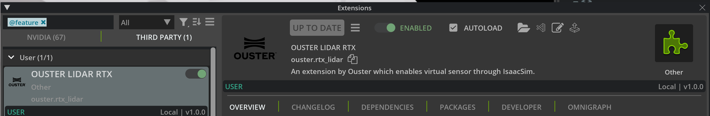
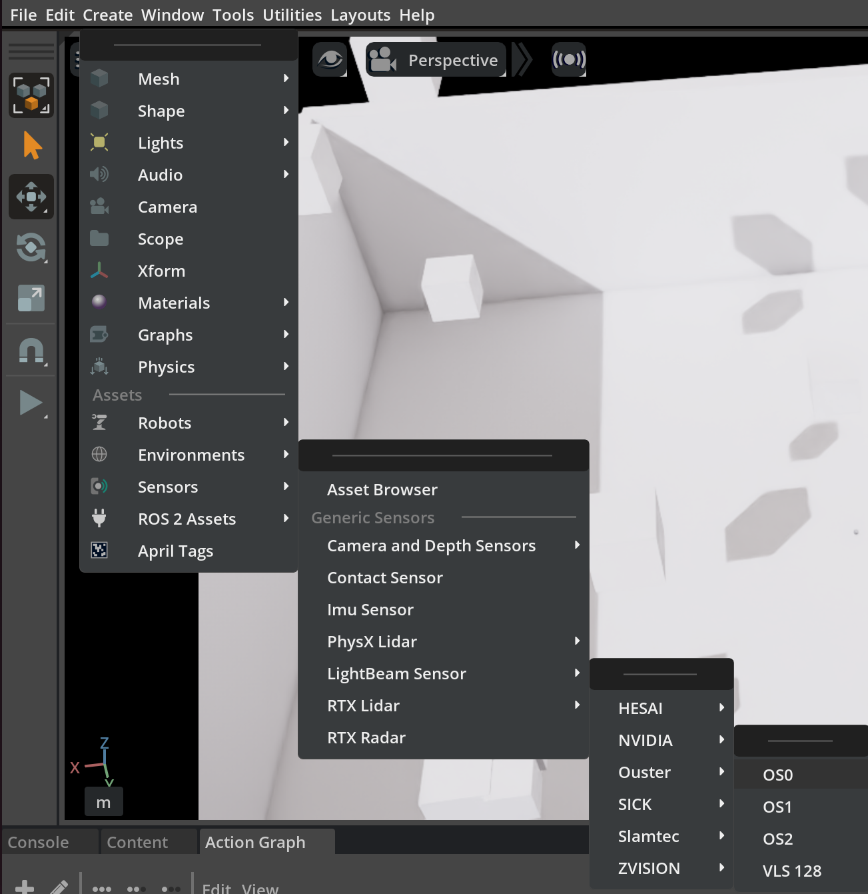
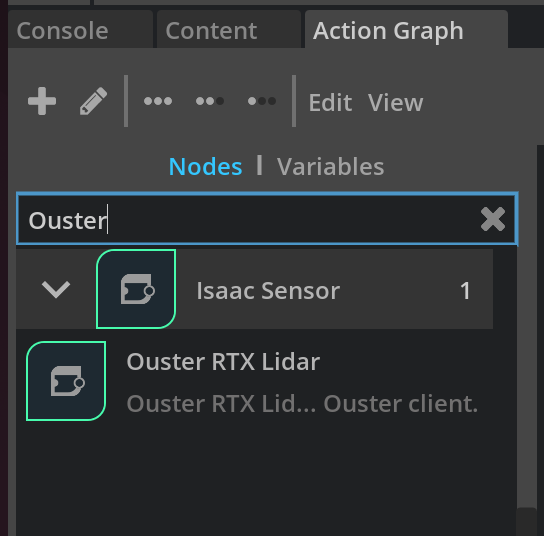
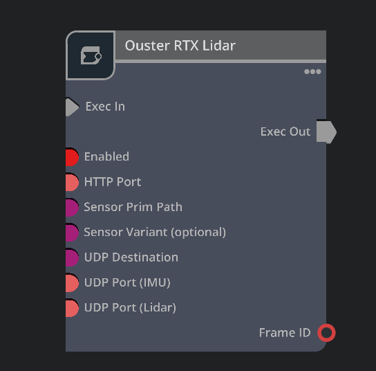
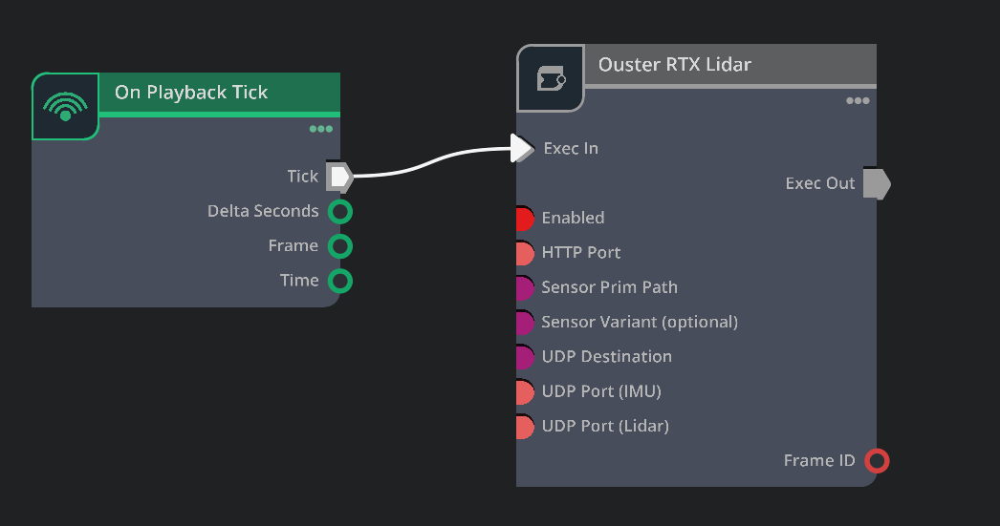
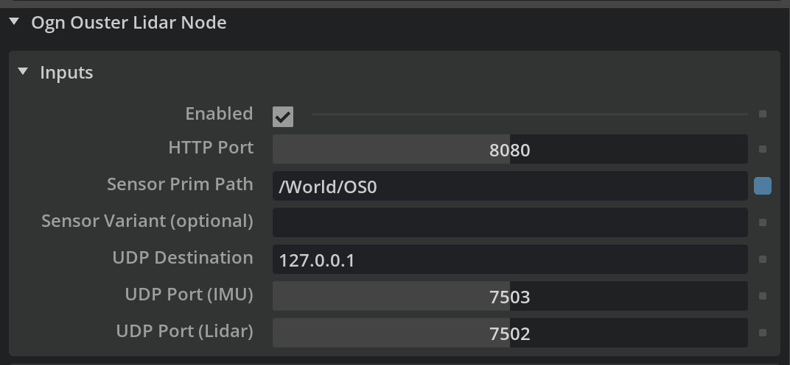

# Ouster RTX Lidar [ouster.rtx_lidar]

A virtual Ouster using IsaacSim as the backend

## Setup

- Download the extension to a known location
- Open the extensions window and modify the search paths to include where the extension has been installed
- Open the THIRD PARTY tab and you should find the **OUSTER LIDAR RTX** extension under Users
- Enable the extension and also check the **AUTOLOAD** so the plugin is always ready.

## Usage

1. Add an ouster sensor from the **Creat** menu as shown below

2. Next enable **Action Graphs** window from **Window -> Graph Editors** sub menu.

3. Create a new action graph if there wasn't one already.

4. In the Action Graph find the **Search nodes** tab and type `Ouster` the **Ouster RTX Lidar** node
should show as one of the options as shown below
 

5. Drag and drop the Ouster RTX Lidar into the Action Graph

6. In the Action Graph window search again for the `On Playback Tick` node and add the node to the graph

7. Connect the **On Playback Tick** node to the **Ouster RTX Lidar** node as shown below:

Finaly, we need to configure the **Ouster RTX Lidar** node to know which sensor it is used for. Select the
**Ouster RTX Lidar** node from the Action Graph window (or through the **Stage** window). This should show
the node properties in the **Property** window. At minimum the `Sensr Prim Path` should be updated to point
to the Ouster sensor that we added earlier in first step. Your configuration should look like this:

Now you may click on IsaacSim play.